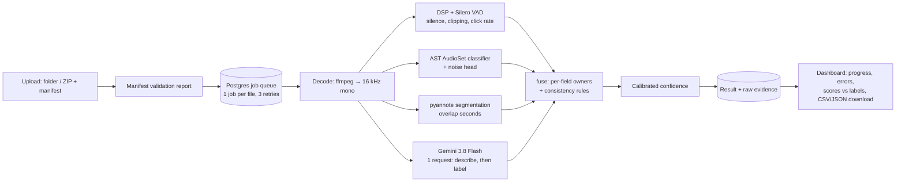

# meTune: technical memo

**Call-audio tone, background noise and audio health, at ≤ $0.003 per audio minute**

| | |
|---|---|
| Hosted dashboard | https://metune-dev.mehathab.dev (login required) |
| Repository | https://github.com/CraftedByMehathab/meTune-app |
| Version described | v0.6.0 (`cb1ca29`), 2026-10-28 |
| Run it | [README](../README.md) · deploy: [deploy/DEPLOY.md](../deploy/DEPLOY.md) · releases: [deploy/RELEASE.md](../deploy/RELEASE.md) |

## 1. Summary

meTune takes a batch of call recordings (folder or ZIP, optional label manifest) and returns one schema-valid result per call: customer emotional tone and intensity, background noise (present, type, severity), audio quality, speaker overlap, long silence, and a confidence.

Each field is produced by the cheapest component that measured best for it on held-out data:

| Field | Component | Held-out result |
|---|---|---|
| Emotional tone, intensity | Audio LLM (Gemini 3.8 Flash, 1 call per file) | Natural dialogue (MELD test, n = 1,617): macro F1 **0.38**, accuracy 0.56 |
| Background noise | Local AudioSet classifier (AST, 8-bit ONNX) + trained head, DSP static rule | Accuracy **0.95**, precision 0.94, recall 0.97 (n = 120) |
| Speaker overlap | Local pyannote segmentation **OR** the LLM | Accuracy 0.83, precision 0.90, recall 0.68 (n = 120) |
| Long silence, audio quality | DSP + voice activity detection (Silero, ONNX) | Silence accuracy 0.98 |
| Confidence | P(tone is right), calibrated per predicted tone | ECE **0.044** on MELD test |

- **Cost:** $0.0014 per audio minute on a 2.9-minute call. A call costs about $0.001 fixed plus $0.0011 per minute, which stays under the $0.003 ceiling for calls longer than about 30 s.
- **Latency:** 15–40 s per call on a 4-vCPU VM, dominated by the single LLM request.
- **Data leaving the VM:** only the call audio and the prompt, sent to the Gemini API.
- **Trial calls (held out):** 15 of 21 fields right, including noise and overlap on all 3.
- **Biggest open risk:** tone on real customer calls. No approach tried got more than 1 of 3 trial-call tones right, and 3 calls cannot separate them. Section 9 covers what would resolve it.

## 2. Constraints that shaped the design

- **Hidden test set:** nothing may be fitted to the 3 provided calls. They were used only as a final held-out check, never for tuning or for diagnosing individual errors.
- **Cost ceiling of $0.003 per audio minute:** at most one LLM request per call. Everything else runs locally on the CPU.
- **Fields are scored separately:** each field has its own owner, and fusion rules are explicit and tested. Noise is never inferred from poor audio quality, and tone is never inferred from loudness alone.
- **Confidential audio:** one external service (Gemini API, paid tier), approved for this trial before use and disclosed in section 8.

## 3. Final architecture



- **Ownership and fusion:** every field has one owner, and the fusion rules are deterministic, so the output stays schema-valid if any component fails.
  - Tone and intensity come from the LLM.
  - Noise comes from AST plus its head. A DSP click-rate static rule can add "static", but only when AST also hears clicks or static.
  - Overlap is flagged if pyannote **or** the LLM detects it.
  - Silence and quality come from DSP. The LLM can only escalate quality to "severely impaired".
- **Failure isolation:** each file is its own job. A decode error fails that file only.
- **Degraded mode:** if the LLM request fails after retries, noise, overlap, silence and quality still come from the local models. Tone falls back to neutral with confidence 0.2.
- **Reproducibility:** every threshold, model id and price lives in `config.yaml`. Its hash is stored on every batch, and model ids and timings are logged per result. Images are built by CI and tagged with the git SHA.

## 4. Approaches compared

At least two materially different approaches were compared for each hard field. All selections were made on a validation split. Each test split was scored once, after selection. Negative results are kept.

**Tone**

| Approach | Acted proxy (CREMA-D, phone channel) | Natural dialogue (MELD) | Verdict |
|---|---|---|---|
| Audio LLM, prompt-only: 3 prompt designs, thinking levels, 2 Gemini sizes, plus a local open model (Qwen2.5-Omni 7B) | ≈ always "neutral" (macro F1 0.07–0.08) | **0.38** | **Shipped** |
| Fine-tuned speech-emotion model: wav2vec2 fine-tuned on CREMA-D, 5-model bootstrap bag, customer-channel filter, 8-bit ONNX | **0.65** (0.50 with the wideband agent) | 0.19 | Kept as an option (`tone_source: ser`) |
| Speech-emotion bag + per-tone decision bias tuned on validation | 0.61 (agent channel, from 0.50) | 0.19 | Shipped in v0.5.0, replaced |
| Fusion of the LLM and the speech-emotion bag (weight tuned on MELD dev) | — | 0.33 | Rejected: LLM alone was better on dev |

The two evaluation sets disagree, and the reason is how they were built. CREMA-D sentences are semantically neutral by design, so only the voice carries the emotion. An LLM that relies on wording sees nothing there. The fine-tuned model learned acted prosody and labels 84% of neutral conversational lines as emotional. Customer calls are natural speech, where words and voice both carry emotion, so the natural-speech result decided the choice.

**Background noise:** the LLM alone reached accuracy 0.61 (Flash-Lite) and 0.74 (3.8 Flash). AST used zero-shot reached 0.75. **AST with a trained head reached 0.87.** The head was then made robust to silence, and the static rule was made to require AST confirmation (it had fired on word onsets), bringing accuracy to **0.95**. Adding the LLM on top gained one call and was not worth the cost. Blending LLM and AST severity was tested and rejected (−1 call on test).

**Speaker overlap:** the LLM alone reached recall 0.40, pyannote alone 0.47, both together (AND) 0.19, and **either one (OR) 0.68 at precision 0.90**.

## 5. Validation

**Data.** No labelled production audio was available beyond the 3 trial calls, so three tiers were used:

1. **Synthetic proxy calls**, 840 in total. Two-party conversations were built from CREMA-D clips (tone labels kept only where voice-only raters agreed) and ESC-50 or synthetic noise at 3, 10 or 20 dB SNR, with planned overlaps and long silences. They were passed through a phone channel (300–3,400 Hz, 8 kHz, Opus). Some splits also have a wideband VoIP "agent" leg, as in the trial calls.
2. **MELD**: natural conversational speech (*Friends*), used only for tone, through the same phone channel. Clips shorter than 1.5 s were dropped. The mapping was fixed before looking at results: neutral → neutral, joy → satisfied, anger → upset, fear → distressed, disgust → frustrated. Sadness and surprise were dropped, as CREMA-D's sad class was.
3. **The 3 trial calls**: held out completely.

**Leakage controls**
- Proxy splits are speaker-disjoint: tuning uses actors 1036–1045 and testing uses actors 1046–1091. They are also noise-clip-disjoint: ESC-50 folds 1–3 for tuning, folds 4–5 for testing.
- Every threshold, head and fusion weight was fitted on the tuning split only, and each test split was scored once per selected configuration.
- The confidence calibrator was fitted on out-of-fold predictions, after an in-sample fit was found to be over-confident.

**Label audit.** Re-measuring overlap labels with VAD on the separate speaker tracks showed that only 3 of 28 (validation) and 2 of 33 (test) planned overlaps had at least 0.5 s of real simultaneous speech. The rest fell on the silent edges of the clips. New overlap splits were built with measured overlaps (49 and 53 per 120 calls), and all overlap numbers above use them. The broken labels had explained why every earlier overlap detector scored near zero.

**Tone on natural dialogue: MELD test, n = 1,617, Gemini 3.8 Flash**

| | Neutral | Satisfied | Frustrated | Upset | Distressed |
|---|---|---|---|---|---|
| Support | 934 | 294 | 62 | 281 | 46 |
| Recall | 0.71 | 0.53 | 0.34 | 0.22 | 0.21 |

Confusion matrix (rows = true, columns = predicted):

| | N | S | F | U | D |
|---|---|---|---|---|---|
| **N** | 659 | 168 | 75 | 18 | 14 |
| **S** | 113 | 156 | 17 | 4 | 4 |
| **F** | 21 | 7 | 21 | 11 | 2 |
| **U** | 96 | 23 | 83 | 62 | 16 |
| **D** | 23 | 5 | 7 | 2 | 10 |

Macro F1 0.379 and accuracy 0.562. For comparison, always predicting neutral gives macro F1 0.146 at accuracy 0.578, and the speech-emotion bag gives 0.188 at 0.234.

**Other fields: proxy test splits, unseen speakers and noise clips**

| Field | Metric | Result |
|---|---|---|
| Background noise present | accuracy · precision · recall | 0.95 · 0.94 · 0.97 (n = 120) |
| Noise type (on detected noisy calls) | accuracy | 0.85 |
| Noise severity | accuracy · macro F1 | 0.58 · 0.46 |
| Speaker overlap | accuracy · precision · recall | 0.83 · 0.90 · 0.68 (n = 120, 53 positives) |
| Intensity (LLM, emotional calls) | accuracy | 0.64 |
| Long silence | accuracy | 0.98 |
| Audio quality | accuracy | 1.00, but every proxy call is labelled "clear", so this only shows there are no false alarms |

**Trial calls, held out (n = 3), v0.6.0:** noise 3/3, overlap 3/3, quality 3/3, long silence 3/3, severity 2/3, intensity 1/3, tone 0/3. That is 15 of 21 fields. Tone was also 0/3 or 1/3 for every earlier version, so 3 calls cannot rank the tone approaches.

## 6. Confidence and ambiguous tone

`confidence` is the probability that the tone is right. For each tone the LLM can pick, it is how often that pick was right on MELD dev, shrunk toward the overall accuracy so rarely picked tones do not get extreme values.

| LLM picks | neutral | satisfied | frustrated | upset | distressed |
|---|---|---|---|---|---|
| confidence | 0.73 | 0.52 | 0.13 | 0.79 | 0.47 |

On MELD test the expected calibration error is 0.044: mean confidence 0.61 against 56% right, and no wrong answer scored at 0.9 or above. Before calibration, the speech-emotion pipeline reported a mean of 0.92 at 23% right.

**Ambiguous tone** is handled through the confidence value, not hidden. A "frustrated" pick is reported with confidence 0.13 because it is usually wrong. Anything below 0.5 should be treated as "needs review". The dashboard does not show a review flag yet (section 9).

## 7. Cost and latency

**Price**
- Model: Gemini 3.8 Flash, $0.75 per 1M input tokens (text and audio) and $3.75 per 1M output tokens. These are list prices valid until 2026-12-31.
- Usage: one request per file, thinking level "low".
- Local models: AST, pyannote and Silero run on the VM CPU at no API cost.

**Measured cost per audio minute**

| Calls | Average length | $/audio-min |
|---|---|---|
| Proxy test calls | 0.54 min | 0.0028–0.0030 |
| Trial call | 2.9 min | 0.0014 |
| All 3 trial calls together | 1.3 min | 0.0018 |

Fitting these gives about **$0.00098 fixed per call (the prompt) + $0.00107 per audio minute**. Calls shorter than about 31 s exceed $0.003/min, and longer calls fall below it. A typical 1–3 minute call costs $0.0013–0.0020/min. The hosting cost is separate: one VM (4 vCPU, 8 GB) at about $73/month, which works out to about $0.0007/min at 100k audio minutes per month.

**Latency on the hosted VM (v0.6.0)**

| Call length | End-to-end, upload to result |
|---|---|
| 31 s | 14.8 s |
| 35 s | 16.6 s |
| 2.9 min | 40.0 s |

The LLM request dominates. Local components cost about 1.0 s of CPU (AST) and 0.1 s (pyannote) per 30 s of audio. In a local batch run (6 files in parallel), throughput was about 2.2 s per audio minute.

## 8. Privacy and vendor disclosure

| | |
|---|---|
| External service | Google Gemini API, paid tier. The only one used, approved for this trial before use |
| What is sent | The call audio (16 kHz mono FLAC), a short prompt and 5 numeric audio measurements. No file names, no labels |
| Training use | None. On paid services, Google does not use prompts or responses to improve its products |
| Retention | Logged "for a limited period of time, solely for detecting and preventing violations" of the usage policy, and for legal disclosures. No exact period is stated |
| Location | "May be stored transiently or cached in any country in which Google or its agents maintain facilities"; governed by Google's Data Processing Addendum |
| Everything else | Runs on the VM. Uploads and results stay in its Postgres database and Docker volume. The repository contains no call audio, labels or trial predictions; the predictions for the 3 calls are delivered separately |
| Evaluation data | CREMA-D, ESC-50 and MELD, used offline for evaluation only and not redistributed |

Fully local operation is possible: noise, overlap, silence and quality need no API, and `tone_source: ser` gives local tone, with the accuracy trade-off shown in section 4.

## 9. Failure modes, limits and next steps

| Limit | Impact | Next step |
|---|---|---|
| Tone on real calls is unproven: no approach above 1 of 3 on the trial calls; MELD is TV dialogue, not phone calls | The main accuracy risk for the hidden set | Label 20–30 real calls, use them to choose between `llm` and `ser` and to recalibrate, and keep the 3 trial calls as the final check |
| "Frustrated" and "distressed" are weak (MELD recall 0.34 and 0.21) | Macro F1 is capped by these classes | Real-call labels; a natural-speech fine-tune (MELD train) for the speech-emotion option |
| Severity accuracy 0.58 | Off by one level on about 4 in 10 noisy calls | Estimate severity from a measured noise-to-speech level rather than class scores |
| Noise types outside the 7 trained ones are named by a zero-shot rule (a TV was named "keyboard typing") | The type is unscored but visible to users | Add TV and music examples to the proxy set and refit the head |
| Short calls (< ~30 s) exceed $0.003/min. The model price doubles on 2027-01-01 | Cost ceiling | A smaller model for short calls; a shorter prompt (the LLM's description text is billed output) |
| Dependency on the LLM | During an outage, tone falls back to neutral with confidence 0.2; other fields keep working | Retry and backoff are in place; `tone_source: ser` is a local fallback |
| Audio-quality rule uses clipping only, and the proxy has no impaired calls | Impaired audio from other causes (dropouts, codec damage) is missed | Add impaired proxy calls and a dropout detector |
| Overlap recall 0.68 on stitched, acted turns; real interruptions are shorter | Short interruptions are missed | Real-call labels |
| No review flag in the UI; single VM; tables are created on boot (no migrations) | Operational | Low-confidence badge; Alembic; a second worker host if volume grows |

## 10. Reproducing the results

```bash
make setup && cp .env.example .env              # add GEMINI_API_KEY
uv run metune run <folder> --out results.csv     # CLI: one result row per file
make dev                                         # local dashboard on :5173
```

- **Experiments:** every experiment has its script in `eval/` and its outputs in `eval/runs/<timestamp>_<id>/` (`summary.json` with config hash and metrics, `predictions.csv`). `make mlflow-ui` shows all runs side by side.
- **Proxy data:** `eval/build_proxy.py` rebuilds it deterministically from public sources (CREMA-D, ESC-50) given the seeds in the run summaries.
- **Model files:** the 8-bit AST model is rebuilt by `eval/export_ast_onnx.py`. The pyannote and Silero models are vendored in the package.
